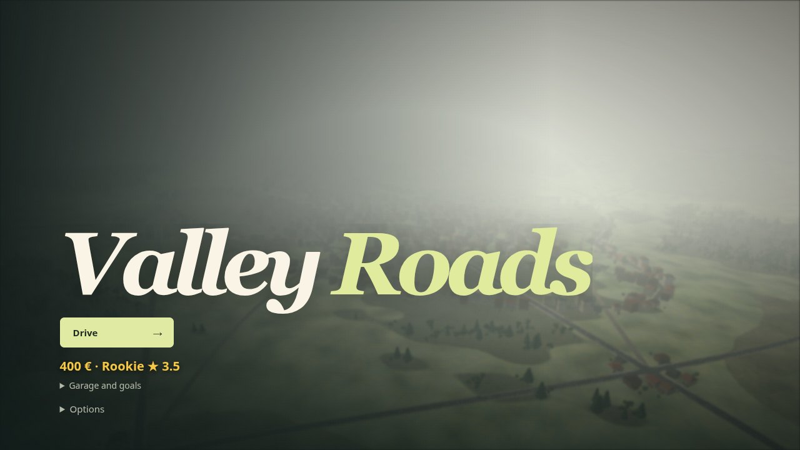
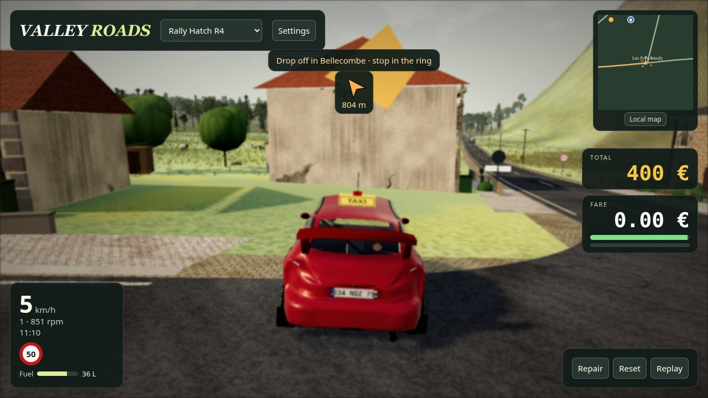
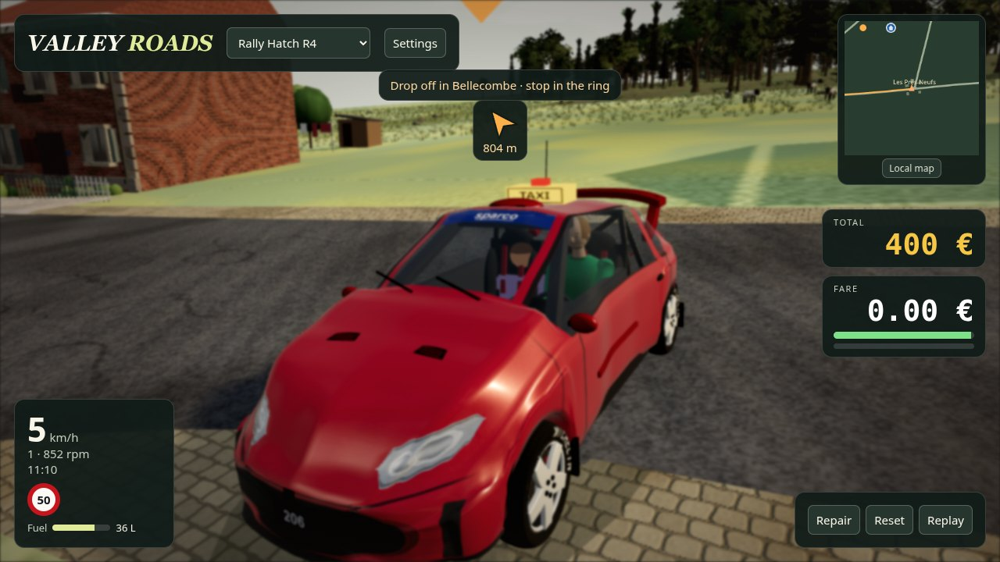
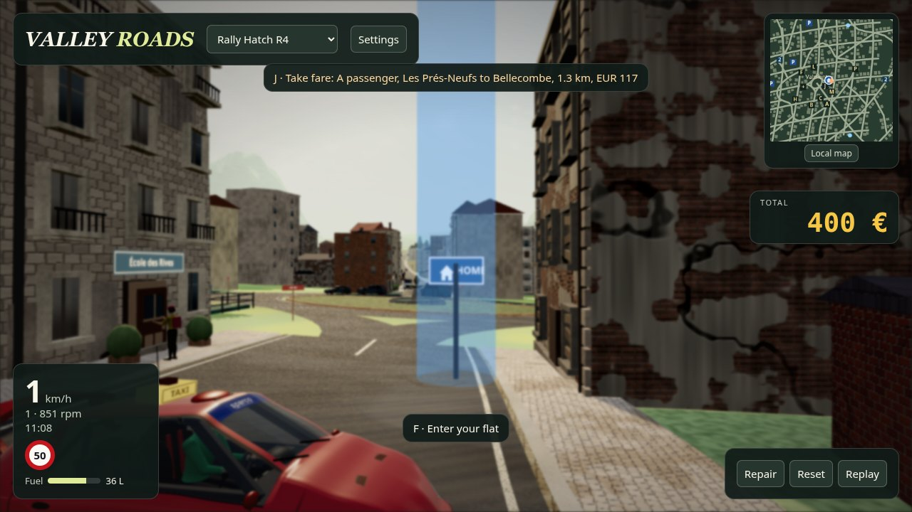
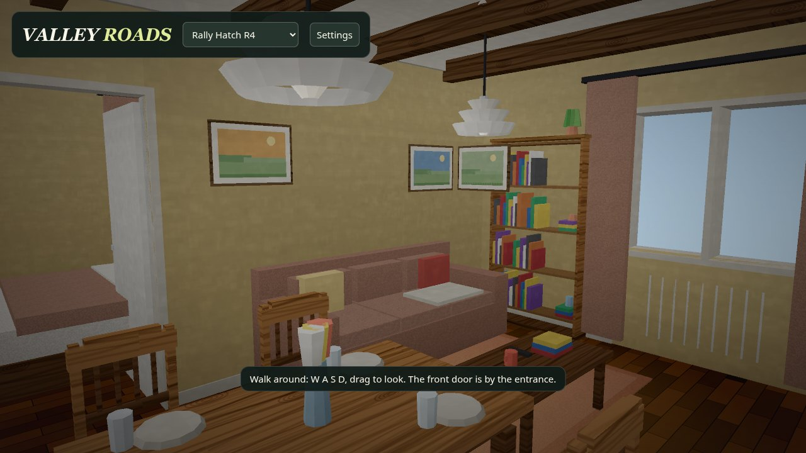

# Valley Roads

A taxi driving sandbox in a generated valley. Pick up passengers, earn tips, pay the rent, dodge the police,
and go home to a flat built entirely by code. No asset files; it runs offline. Current state is buggy.

**[Play it in your browser](https://markldn.github.io/valley-roads/)**



| | |
| --- | --- |
|  |  |
|  |  |

## Play

```sh
python3 -m http.server 8764 --bind 127.0.0.1
```

Open <http://127.0.0.1:8764/> in a WebGL 2 browser and press **Drive**.
Add `?seed=Alpine&time=10` to the address for a mountain region at 10:00.

**Keys:** WASD drive, Space handbrake, H horn, C camera, V weather, J take a fare, F enter a building or
your flat, G get in or out of a car, K repair, R restart, B replay.

## Build

```sh
npm ci && npm run build
```

Writes a minified copy to `dist/`. Every push to `main` rebuilds and publishes the web version. The game is in `src/` (`world`, `traffic`, `people`, `animals`, `taxi`,
`home`, `player`, `render`, `drive`); three.js is bundled in `src/vendor/` under its MIT licence.
